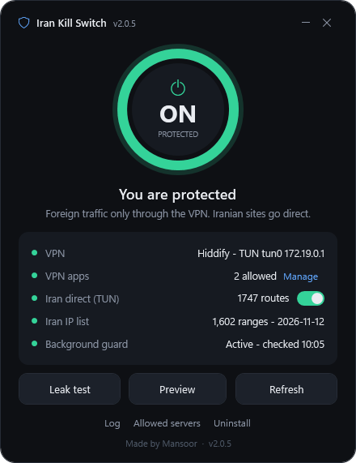
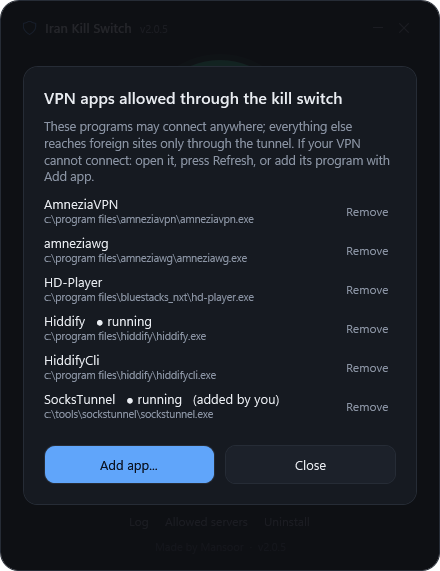
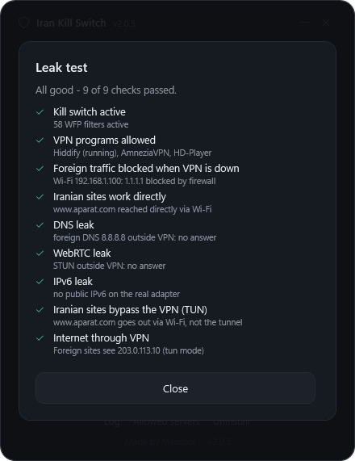
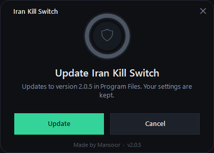
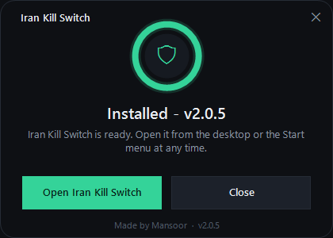

# Iran Kill Switch

**A selective VPN kill switch for Windows.**
Iranian sites go direct. Everything else goes only through your VPN.
If the VPN drops, foreign traffic is blocked, never leaked.

[English](README.md) · [فارسی](README.fa.md)

---

## Why

Most VPN clients have no real kill switch. When the app closes or crashes, Windows sends
foreign traffic through your normal connection again, with your real IP. Iran Kill Switch
fixes this at the operating-system level, independent of the VPN client, while keeping
Iranian sites fast and direct.

## Features

- **Works with any VPN, without touching its settings**: Hiddify, v2rayN, Clash, sing-box,
  AmneziaVPN, AmneziaWG, WireGuard, OpenVPN, SSH tunnels (MobaXterm), BlueStacks and more.
  VPN programs are detected automatically; helpers they start are allowed too.
- **Real kill switch**: native Windows Filtering Platform filters, active from boot,
  before any VPN starts. Block rules win over every Windows Firewall allow rule.
- **Iran direct**: about 1,600 Iranian IPv4 ranges (RIPE NCC + ipdeny, auto-updated) stay
  outside the VPN. For TUN-mode VPNs the tool adds direct routes, so no VPN config is needed.
- **No leaks**: DNS, WebRTC (STUN) and IPv6 are covered. Built-in leak test.
- **Safe by design**: every change is applied in one transaction; turning on auto-undoes
  itself in 2 minutes unless you confirm; Emergency OFF and full uninstall restore everything.
  Windows Firewall settings are never changed.
- **Self-managing**: a background guard repairs filters, refreshes the Iran list and finds
  new VPN programs.
- **Zero dependencies**: only what ships with Windows 10/11. One 80 KB installer.

## Screenshots

| Main window | VPN apps | Leak test |
|:---:|:---:|:---:|
|  |  |  |

| Installer | Installed |
|:---:|:---:|
|  |  |

## Download

Get **`IranKillSwitch-Setup-<version>.exe`** from the
[latest release](https://github.com/saateon/iran-kill-switch/releases/latest), run it and accept
the Windows admin prompt. Run a newer setup to update; your settings are kept.

> The installer is not code-signed, so Windows SmartScreen may show
> "Windows protected your PC". Choose **More info -> Run anyway**.

## Quick start

1. Open **Iran Kill Switch** from the desktop or Start menu.
2. Click the **big ring** to turn protection on. A short leak test runs.
3. Press **Keep protection**. (Without it, everything is undone after 2 minutes.)

If your VPN cannot connect: open it, press **Refresh**, or add its program under
**VPN apps -> Manage -> Add app**.

## Documentation

| Topic | |
|---|---|
| [Install, update, uninstall](docs/install.md) | requirements, silent install, Emergency OFF |
| [Using the app](docs/usage.md) | every control, VPN apps, Iran direct, troubleshooting |
| [How it works](docs/how-it-works.md) | WFP filter model, routes, guard, safety net |
| [Build from source](docs/build.md) | project layout, tests, versioning, making the installer |
| [FAQ and limits](docs/faq.md) | what is covered, what is not |
| [Agent brief](AGENTS.md) | compact technical summary for AI coding assistants |

## License

[MIT](LICENSE) · Made by Mansoor
