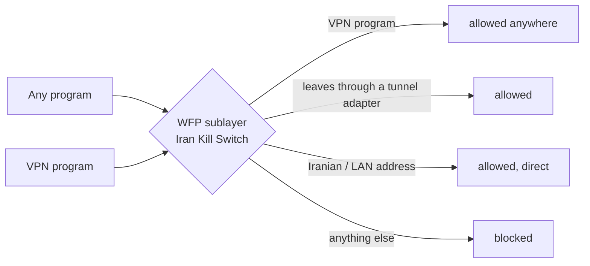

# How it works

[Back to README](../README.md)

## Filters

The tool talks to the Windows Filtering Platform directly (C# P/Invoke, no driver).
It owns one provider and one sublayer with fixed GUIDs, so its objects can always be found
and removed. Filters are persistent (active from boot, before any VPN starts) and are
written in **one transaction**: either the whole set is replaced or nothing changes.

Layers: `ALE_AUTH_CONNECT` and `ALE_AUTH_RECV_ACCEPT`, IPv4 and IPv6.

| Weight | Permit | Condition |
|---|---|---|
| 15 | loopback | flag `IS_LOOPBACK` |
| 14 | each VPN program | `ALE_APP_ID` |
| 13 | tunnels | interface type 53 (wintun, WireGuard), 23 (PPP), 131; plus learned TAP addresses |
| 12 | Iran + LAN + allowed servers | remote address ranges (IPv4, 1,000 per filter); IPv6: link-local, multicast, ULA |
| 1 | **block** | everything else |

A block in this sublayer beats every allow rule in Windows Firewall, so the 180-odd
built-in allow rules cannot open a hole. Windows Firewall itself is never modified.

## Iran direct

TUN-mode VPNs route all traffic into their adapter. The tool adds about 1,750 CIDR routes
for Iranian ranges via your real gateway (IP Helper API). They are more specific than the
VPN's routes, so Iranian traffic leaves directly without any VPN configuration.
Routes live in the active store only and are re-synced by the guard after reboots and
network changes.

## Iran IP list

RIPE NCC delegated statistics (country `IR`) merged with ipdeny's aggregated zone,
sanity-checked (at least 300 ranges, 4 to 40 million addresses) and written atomically.
A bundled copy makes the first run work offline. Refreshed weekly.

## Background guard

Scheduled task `IKS-Guard` (SYSTEM) at boot, every 5 minutes and on network changes:
refreshes the Iran list, finds VPN programs and their helpers, re-applies filters if
anything changed or was removed, and keeps the Iran routes on the current gateway.

## Safety net

- Turning on first schedules `IKS-AutoRevert` (+2 minutes); confirming cancels it.
- Any error while applying aborts the transaction: the previous state stays.
- `Emergency OFF` removes everything even if the app's files are damaged.
- Settings are written atomically; a corrupt file falls back to safe defaults.

## App

WPF window hosted in-process by `IranKillSwitch.exe` (one process, own icon, no console).
All work runs in background runspaces; the window never freezes. Single instance, tray
icon, scales down on small screens.
