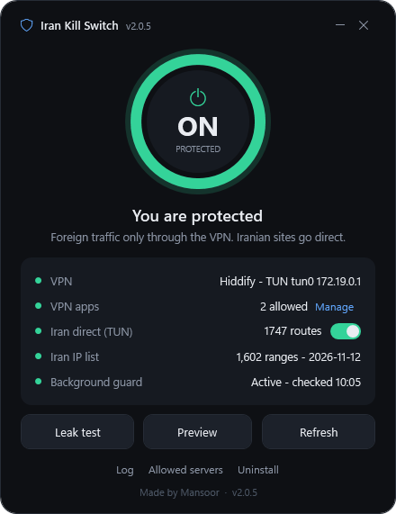
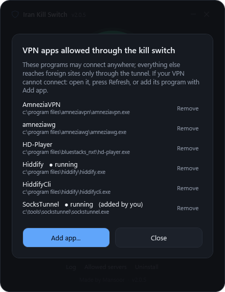
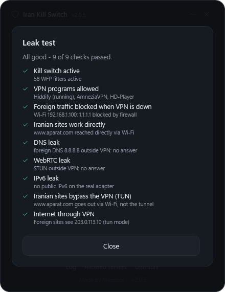

# Using the app

[Back to README](../README.md)

## The ring

The big ring is the on/off switch and the status at the same time.

| Ring | Meaning |
|---|---|
| Grey, `OFF` | not protected; hover shows *CLICK TO TURN ON* |
| Green, breathing | protected |
| Amber | on, but waiting for your confirmation or something needs attention |

Keyboard: `Tab` to the ring, then `Enter` or `Space`.

**Turning on** runs a leak test and asks *Is everything working?*. Press
**Keep protection**. If you do nothing, everything is undone after 2 minutes, so a
mistake can never leave you without internet.

## Rows

| Row | |
|---|---|
| VPN | which VPN program is running and in which mode (TUN or proxy) |
| VPN apps | how many VPN programs may connect; **Manage** opens the list |
| Iran direct (TUN) | switch; for TUN-mode VPNs, Iranian sites skip the tunnel |
| Iran IP list | ranges and date; refreshed weekly |
| Background guard | last automatic check |

## VPN apps

Only these programs may reach foreign addresses directly; everything else must go
through a tunnel. They are found automatically (running programs, services and the usual
install folders). Programs that an allowed app starts itself, for example MobaXterm's
`MobaRTE.exe`, are allowed within 15 seconds. Windows' own programs never are.

- **Add app...** choose the VPN program's `.exe`
- **Remove** takes a program off the list; it is not re-added by later scans

## Buttons

| | |
|---|---|
| Leak test | foreign traffic without VPN, Iranian sites, DNS, WebRTC, IPv6, Iran direct, internet through VPN |
| Preview | what turning on will do; changes nothing |
| Refresh | finds new VPN programs, updates the Iran list |
| Log | activity log |
| Allowed servers | optional: a server to allow without allowing a whole program (built-in Windows VPN, a SOCKS5 proxy set in a browser extension); one per line: IP, CIDR, domain or share link |

 

## Leak test

The test opens connections bound to your real network adapter, which is exactly how
traffic leaves when a VPN dies. So it proves the kill switch without closing your VPN.

 

## Troubleshooting

| Problem | Fix |
|---|---|
| VPN cannot connect while protection is on | open the VPN, press **Refresh**; still not: **Manage -> Add app** |
| SOCKS5 in a browser extension does not work | add the proxy server under **Allowed servers** |
| Iranian sites go through the VPN | use the VPN in TUN mode and keep **Iran direct** on; VPNs with their own kill switch ("block untunneled traffic") must have it turned off |
| Windows shows "No internet" while the VPN is off | expected: Windows' connectivity check server is foreign; Iranian sites work |
| Something is wrong | Start menu -> **Emergency OFF** |
