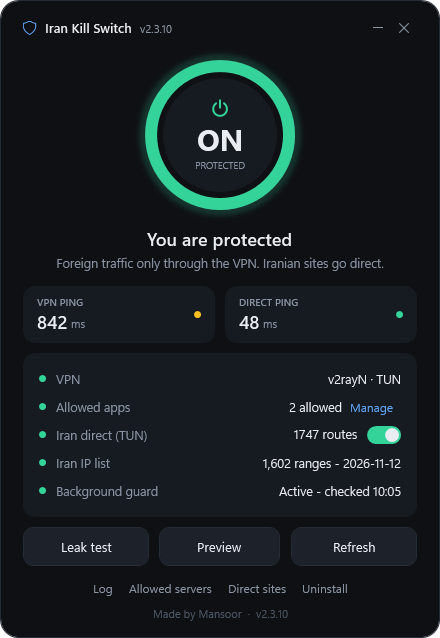
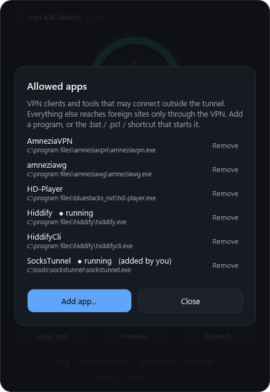
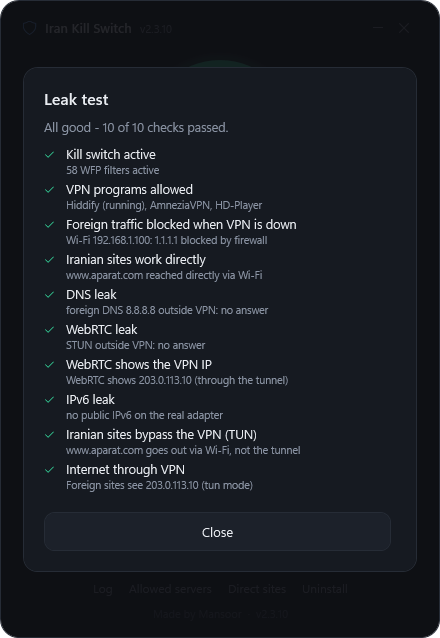

# Using the app

[Back to README](../README.md)

## The ring

The big ring is the on/off switch and the status at the same time.

| Ring | Meaning |
|---|---|
| Grey, `OFF` | not protected; hover shows *CLICK TO TURN ON* |
| Green, breathing | protected |
| Amber | on, but waiting for your confirmation or something needs attention |

Keyboard: `Tab` to the ring, then `Enter` or `Space`.

**Turning on** runs a self-test. If every check passes and an Iranian site is reachable,
protection simply stays on. If a check fails you are asked *Is everything working?*:
**Keep protection** or **Undo now**. If you do nothing, everything is undone after 2 minutes, so a
mistake can never leave you without internet.

## Ping

| Card | |
|---|---|
| VPN PING | round trip inside the VPN tunnel to a foreign server, on an open connection (what your VPN client shows) |
| DIRECT PING | round trip straight to an Iranian site through your normal internet |

Green below 300 ms, amber below 1000 ms, red slower or no answer. Refreshed every 3 seconds while the window is open.

## Rows

| Row | |
|---|---|
| VPN | the client that really carries the traffic (found from its connections) and the mode, e.g. `v2rayN · TUN`; no name when it cannot be proven |
| Allowed apps | how many programs may connect outside the tunnel; **Manage** opens the list |
| Iran direct (TUN) | switch; for TUN-mode VPNs, Iranian sites skip the tunnel; shows `+ N direct sites` |
| Iran IP list | ranges and date; refreshed weekly |
| Background guard | last automatic check |

## Allowed apps

Only these programs may reach foreign addresses directly; everything else must go
through a tunnel. They are found automatically (running programs, services and the usual
install folders). Programs that an allowed app starts itself, for example MobaXterm's
`MobaRTE.exe`, are allowed within 15 seconds, and only while they run. Windows' own programs
(PowerShell, cmd, curl...) never are: allowing one would let every script bypass the kill switch.

- **Add app...** choose a program (`.exe`), or the `.bat` / `.cmd` / `.ps1` / shortcut that starts it.
  The programs it starts are allowed (`xray_no_window.cmd` -> `xray.exe`). A tool written in PowerShell
  with no program of its own gets a private PowerShell copy and a desktop shortcut *Name (Kill Switch)*:
  start it from that shortcut.
- **Remove** takes a program off the list; it is not re-added by later scans

## Buttons

| | |
|---|---|
| Leak test | foreign traffic without VPN, Iranian sites, DNS, WebRTC, IPv6, Iran direct, internet through VPN |
| Preview | what turning on will do; changes nothing |
| Refresh | finds new VPN programs, updates the Iran list, re-applies the direct sites |
| Log | activity log |
| Direct sites | your list of sites that skip the VPN, one per line: `example.com`, a URL, an IP or a CIDR. Save and close Notepad to apply. Only while protection is ON. Add every domain the site uses (its CDN or API domains too) |
| Allowed servers | optional: a server to allow without allowing a whole program (built-in Windows VPN, a SOCKS5 proxy set in a browser extension); one per line: IP, CIDR, domain or share link |

 

## Leak test

The test opens connections bound to your real network adapter, which is exactly how
traffic leaves when a VPN dies. So it proves the kill switch without closing your VPN.

 

## Troubleshooting

| Problem | Fix |
|---|---|
| VPN cannot connect while protection is on | open the VPN, press **Refresh**; still not: **Manage -> Add app** |
| WebRTC test shows no IP | proxy mode never carries WebRTC (UDP): switch the VPN app to TUN / VPN mode. In TUN mode the VPN server must carry UDP too |
| SOCKS5 in a browser extension does not work | add the proxy server under **Allowed servers** |
| A direct site still shows the VPN IP | TUN mode: turn off FakeIP in the VPN app. System Proxy mode: keep the app running (it writes the Windows "no proxy" list) and press **Refresh**. The page may load parts from other domains: add them too |
| Iranian sites go through the VPN | use the VPN in TUN mode and keep **Iran direct** on; VPNs with their own kill switch ("block untunneled traffic") must have it turned off |
| Windows shows "No internet" while the VPN is off | expected: Windows' connectivity check server is foreign; Iranian sites work |
| Something is wrong | Start menu -> **Emergency OFF** |
